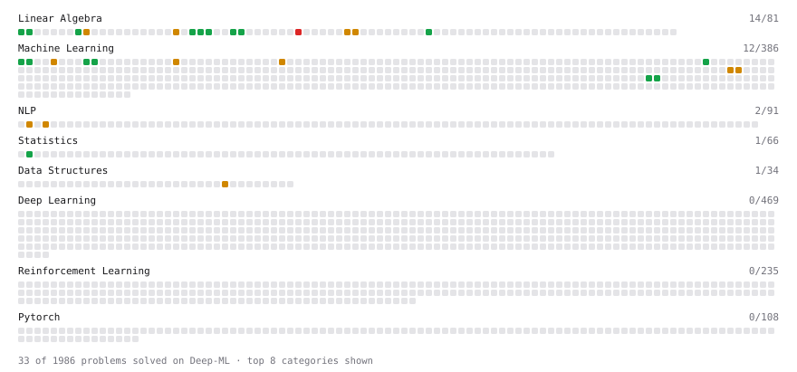

# Deep-ML

My machine learning practice from [Deep-ML](https://www.deep-ml.com). Every solution here was written by hand.

**50** solved · 35 problems · 0 labs · 15 math

[**Browse the interactive portfolio**](https://anushreehede.github.io/deep-ml/) to replay this filling in over time.

## Problems

| | Difficulty | Solved | |
| --- | --- | --- | --- |
| [Batch Iterator for Dataset](https://www.deep-ml.com/problems/30) | easy | 2026-11-10 | [solution](problems/0030-batch-iterator-for-dataset) |
| [Calculate 2x2 Matrix Inverse](https://www.deep-ml.com/problems/8) | easy | 2026-10-27 | [solution](problems/0008-calculate-2x2-matrix-inverse) |
| [Calculate Cosine Similarity Between Vectors](https://www.deep-ml.com/problems/76) | easy | 2026-11-02 | [solution](problems/0076-calculate-cosine-similarity-between-vectors) |
| [Derivative of a Polynomial](https://www.deep-ml.com/problems/116) | easy | 2026-10-29 | [solution](problems/0116-derivative-of-a-polynomial) |
| [Descriptive Statistics Calculator](https://www.deep-ml.com/problems/78) | easy | 2026-11-09 | [solution](problems/0078-descriptive-statistics-calculator) |
| [Dot Product Calculator](https://www.deep-ml.com/problems/83) | easy | 2026-10-27 | [solution](problems/0083-dot-product-calculator) |
| [Feature Scaling Implementation](https://www.deep-ml.com/problems/16) | easy | 2026-11-10 | [solution](problems/0016-feature-scaling-implementation) |
| [Gradient Direction and Magnitude](https://www.deep-ml.com/problems/308) | easy | 2026-10-29 | [solution](problems/0308-gradient-direction-and-magnitude) |
| [Implement Compressed Column Sparse Matrix Format (CSC)](https://www.deep-ml.com/problems/67) | easy | 2026-11-02 | [solution](problems/0067-implement-compressed-column-sparse-matrix-format-csc) |
| [Implement Compressed Row Sparse Matrix (CSR) Format Conversion](https://www.deep-ml.com/problems/65) | easy | 2026-11-02 | [solution](problems/0065-implement-compressed-row-sparse-matrix-csr-format-conversion) |
| [Implement Orthogonal Projection of a Vector onto a Line](https://www.deep-ml.com/problems/66) | easy | 2026-10-29 | [solution](problems/0066-implement-orthogonal-projection-of-a-vector-onto-a-line) |
| [L2 Normalization Along an Axis](https://www.deep-ml.com/problems/1022) | easy | 2026-11-02 | [solution](problems/1022-l2-normalization-along-an-axis) |
| [Linear Regression Using Gradient Descent](https://www.deep-ml.com/problems/15) | easy | 2026-10-30 | [solution](problems/0015-linear-regression-using-gradient-descent) |
| [Linear Regression Using Normal Equation](https://www.deep-ml.com/problems/14) | easy | 2026-10-29 | [solution](problems/0014-linear-regression-using-normal-equation) |
| [Matrix-Vector Dot Product](https://www.deep-ml.com/problems/1) | easy | 2026-10-27 | [solution](problems/0001-matrix-vector-dot-product) |
| [Min-Max Scaling of Feature Values](https://www.deep-ml.com/problems/112) | easy | 2026-11-10 | [solution](problems/0112-min-max-scaling-of-feature-values) |
| [Pairwise Cosine Similarity Matrix](https://www.deep-ml.com/problems/1072) | easy | 2026-11-02 | [solution](problems/1072-pairwise-cosine-similarity-matrix) |
| [Random Shuffle of Dataset](https://www.deep-ml.com/problems/29) | easy | 2026-11-10 | [solution](problems/0029-random-shuffle-of-dataset) |
| [Random Train/Validation/Test Split with Shuffling](https://www.deep-ml.com/problems/1058) | easy | 2026-11-10 | [solution](problems/1058-random-train-validation-test-split-with-shuffling) |
| [Transpose of a Matrix](https://www.deep-ml.com/problems/2) | easy | 2026-10-27 | [solution](problems/0002-transpose-of-a-matrix) |
| [BM25 Ranking ](https://www.deep-ml.com/problems/90) | medium | 2026-11-03 | [solution](problems/0090-bm25-ranking) |
| [Chain Rule for Composite Functions](https://www.deep-ml.com/problems/214) | medium | 2026-10-29 | [solution](problems/0214-chain-rule-for-composite-functions) |
| [Cholesky Decomposition](https://www.deep-ml.com/problems/334) | medium | 2026-10-28 | [solution](problems/0334-cholesky-decomposition) |
| [Dot Product of Two Sparse Vectors](https://www.deep-ml.com/problems/1163) | medium | 2026-11-02 | [solution](problems/1163-dot-product-of-two-sparse-vectors) |
| [Gaussian Elimination for Solving Linear Systems](https://www.deep-ml.com/problems/58) | medium | 2026-10-28 | [solution](problems/0058-gaussian-elimination-for-solving-linear-systems) |
| [Implement Gradient Descent Variants with MSE Loss](https://www.deep-ml.com/problems/47) | medium | 2026-10-30 | [solution](problems/0047-implement-gradient-descent-variants-with-mse-loss) |
| [Implement K-Fold Cross-Validation](https://www.deep-ml.com/problems/18) | medium | 2026-11-10 | [solution](problems/0018-implement-k-fold-cross-validation) |
| [Implement TF-IDF (Term Frequency-Inverse Document Frequency)](https://www.deep-ml.com/problems/60) | medium | 2026-11-03 | [solution](problems/0060-implement-tf-idf-term-frequency-inverse-document-frequency) |
| [Linear Regression - Power Grid Optimization](https://www.deep-ml.com/problems/92) | medium | 2026-10-29 | [solution](problems/0092-linear-regression-power-grid-optimization) |
| [LU Decomposition of a Square Matrix](https://www.deep-ml.com/problems/333) | medium | 2026-10-28 | [solution](problems/0333-lu-decomposition-of-a-square-matrix) |
| [Matrix times Matrix ](https://www.deep-ml.com/problems/9) | medium | 2026-10-27 | [solution](problems/0009-matrix-times-matrix) |
| [Mini-Batch Gradient Descent Step for Linear Regression](https://www.deep-ml.com/problems/803) | medium | 2026-11-02 | [solution](problems/0803-mini-batch-gradient-descent-step-for-linear-regression) |
| [Partial Derivatives of Multivariable Functions](https://www.deep-ml.com/problems/215) | medium | 2026-10-29 | [solution](problems/0215-partial-derivatives-of-multivariable-functions) |
| [Stochastic Gradient Descent Step for Linear Regression](https://www.deep-ml.com/problems/802) | medium | 2026-11-02 | [solution](problems/0802-stochastic-gradient-descent-step-for-linear-regression) |
| [QR Decomposition](https://www.deep-ml.com/problems/201) | hard | 2026-10-28 | [solution](problems/0201-qr-decomposition) |

## Math

| | Difficulty | Solved | |
| --- | --- | --- | --- |
| [Derivatives and Gradients](https://www.deep-ml.com/math-problems/1) | easy | 2026-10-29 | [solution](math/0001-derivatives-and-gradients) |
| [Descriptive Statistics](https://www.deep-ml.com/math-problems/18) | easy | 2026-11-09 | [solution](math/0018-descriptive-statistics) |
| [Gradient Descent Updates](https://www.deep-ml.com/math-problems/5) | easy | 2026-10-29 | [solution](math/0005-gradient-descent-updates) |
| [Matrix Basics](https://www.deep-ml.com/math-problems/9) | easy | 2026-10-27 | [solution](math/0009-matrix-basics) |
| [ML Workflow Basics](https://www.deep-ml.com/math-problems/30) | easy | 2026-11-09 | [solution](math/0030-ml-workflow-basics) |
| [Vector Operations](https://www.deep-ml.com/math-problems/7) | easy | 2026-10-27 | [solution](math/0007-vector-operations) |
| [Why Minibatches: Gradient Variance vs Batch Size](https://www.deep-ml.com/math-problems/130) | easy | 2026-10-29 | [solution](math/0130-why-minibatches-gradient-variance-vs-batch-size) |
| [Inverse and Rank](https://www.deep-ml.com/math-problems/12) | medium | 2026-10-27 | [solution](math/0012-inverse-and-rank) |
| [Least Squares and the Normal Equations](https://www.deep-ml.com/math-problems/34) | medium | 2026-10-29 | [solution](math/0034-least-squares-and-the-normal-equations) |
| [Matrix Multiplication](https://www.deep-ml.com/math-problems/10) | medium | 2026-10-27 | [solution](math/0010-matrix-multiplication) |
| [Multivariate Calculus](https://www.deep-ml.com/math-problems/2) | medium | 2026-10-29 | [solution](math/0002-multivariate-calculus) |
| [NDCG: Gains, Log Discounts and Why It Is Not AUC](https://www.deep-ml.com/math-problems/275) | medium | 2026-11-02 | [solution](math/0275-ndcg-gains-log-discounts-and-why-it-is-not-auc) |
| [Orthogonality and Projections](https://www.deep-ml.com/math-problems/14) | medium | 2026-10-28 | [solution](math/0014-orthogonality-and-projections) |
| [Solving Linear Systems](https://www.deep-ml.com/math-problems/13) | medium | 2026-10-27 | [solution](math/0013-solving-linear-systems) |
| [Matrix Decompositions: LU and QR](https://www.deep-ml.com/math-problems/15) | hard | 2026-10-28 | [solution](math/0015-matrix-decompositions-lu-and-qr) |

---

_This file is regenerated by Deep-ML on every push._
